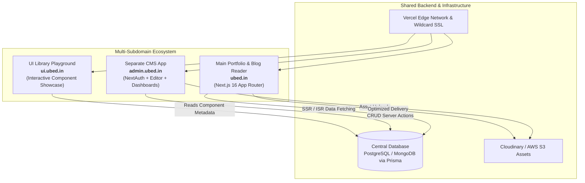

# Ubed Khan — Digital Ecosystem & Portfolio Platform

> **Full-Stack Developer & UI/UX Designer Web Presence**  
> Built with **Next.js 16 (App Router)**, **React 19**, **Strict TypeScript**, **Tailwind CSS**, **GSAP ScrollTrigger**, and **Lenis Smooth Scroll**.

---

## 1. Executive Summary & Vision

This repository houses the flagship web presence for **Ubed Khan**, designed with a signature aesthetic merging **monumental brutalist typography** (`Republica Minor 2.0`), **futuristic neon minimalism**, and **fluid physics-driven micro-interactions**.

Beyond a standard portfolio, this project forms the core hub of a **three-tier multi-subdomain digital ecosystem**:
1. **`ubed.in` (Main Site & Blog Reader)**: The primary public portfolio showcase, interactive experience, and technical blog reader.
2. **`admin.ubed.in` (Dedicated Admin CMS App)**: A standalone admin management dashboard powered by a central database (PostgreSQL/MongoDB via Prisma) to author blog articles, manage portfolio projects, and publish UI components.
3. **`ui.ubed.in` (UI Component Library Showcase)**: A dedicated interactive component library showcasing custom UI primitives, design tokens, and animation sandboxes created by Ubed Khan.

---

## 2. Multi-Domain Architecture & Ecosystem Blueprint



### Domain Tier Breakdown
| Domain / Subdomain | Target Application | Responsibility |
| :--- | :--- | :--- |
| **`ubed.in`** | Main Portfolio + `/blog` | High-impact brutalist typography, pinned GSAP storytelling, zero-SEO-loss server rendered sections, interactive physics Bitmoji, public blog reader. |
| **`admin.ubed.in`** | Separate CMS Application | Protected admin dashboard (Ubed Khan only). Full CRUD for blog posts, featured projects, and UI component registry. |
| **`ui.ubed.in`** | UI Component Library | Dedicated documentation playground and live component sandbox displaying reusable UI components and animations with code copy. |

---

## 3. Technology Stack & Key Libraries

| Layer | Technologies |
| :--- | :--- |
| **Framework** | **Next.js 16.4.6** (App Router, Turbopack, React Server Components) |
| **Runtime & Core** | **React 19.1.0**, **Node.js v22+** |
| **Language** | **TypeScript 5.8** (Strict mode enabled, zero `any` allowance) |
| **Styling** | **Tailwind CSS v3.4**, PostCSS (ESM), Custom Viewport Breakpoints |
| **Display Typography** | Self-hosted **Republica Minor 2.0** (`/fonts/Republica-Minor-2.0.woff`, Zero CLS) |
| **Motion & Scroll Physics** | **GSAP 3.15** (`@gsap/react`, ScrollTrigger), **Framer Motion 12.23**, **Lenis 1.1** |
| **Backend & Routing** | Next.js Route Handlers (`/api/contact`, `/api/blogs`), Server Actions |
| **Planned Database** | **PostgreSQL** (Neon / Supabase) or **MongoDB** managed via **Prisma ORM** |
| **SEO & Structured Data** | JSON-LD (`Person`, `WebSite`, `BlogPosting`, `SoftwareApplication`), Dynamic `sitemap.xml`, `robots.txt`, OpenGraph |

---

## 4. Current Implementation & Features

### 4.1 Zero-SEO-Loss Server Island Architecture
- **Server Components (RSC)** render semantic HTML (`<header>`, `<main>`, `<article>`, `<section>`, `<nav>`, `<h1>`-`<h6>`, `<address>`) directly in the initial HTTP response. Crawlers (Googlebot, Bingbot) index 100% of headings, project details, skills, and JSON-LD schema with zero JavaScript evaluation delay.
- **Client Islands (`"use client"`)** mount interactive physics on top of the DOM without obscuring content:
  - GSAP ScrollTrigger pinned timelines.
  - Framer Motion spring repel physics on buttons and avatars.
  - Lenis smooth scrolling with GPU transform acceleration.

### 4.2 Interactive Landing Page Sections
1. **Hero Section**:
   - Monumental Republica headline (`UBED KHAN`).
   - Dynamic animated text cycler (`PassionText`) switching between *"web developer"* and *"UI/UX designer"*.
   - Interactive Bitmoji avatar with spring repel & tap physics (`HeroInteractiveBitmoji`):
     - **Mobile / Tablet**: Centered in the viewport (`top-[52%] -translate-y-1/2`).
     - **Desktop**: Anchored toward the bottom with dedicated breathing space (`bottom-8` / `bottom-12`).
   - Contact CTA button with hover repel math.
2. **ScrollSlider (Velocity Marquee)**:
   - Dual-row infinite image marquee that dynamically multiplies its scroll speed up to `8x` based on user scroll velocity, decelerating smoothly back to `1x`.
3. **About Me Section (Pinned GSAP Timeline)**:
   - Pins at `top top` for `+=320%` scroll distance.
   - Corner elements (Bubble, Dice, Heart, Diamond) fly in from offscreen with continuous floating bobbing.
   - Glassmorphic card scales in with scroll-scrubbed word-by-word narrative reveal.
   - Dedicated hold/rest phase before unpinning smoothly into Skills.
4. **Skills Section (Pinned GSAP Timeline)**:
   - Pins at `top top` for `+=350%` scroll distance.
   - Corner elements (Laptop, Bulb, Hand, Brain) slide into place.
   - Skill badges sequentially slide in from offscreen across two dynamically balanced rows.
5. **Projects Section (Pinned 3D Stacking Deck)**:
   - Angled dual-ribbon marquee header (`ProjectHead`).
   - 3D card deck where previous cards scale down and dim as new cards slide up from the bottom.
   - Live demo links, GitHub repositories, feature checklists, and tech tags.
6. **Contact Section**:
   - Scroll-driven mask wipe reveal ("LET'S BUILD SOMETHING COOL TOGETHER").
   - Secure contact form submitting to internal Next.js API route `/api/contact`.
7. **Footer**:
   - Monumental typography, social links, contact info, and animated neon geometric SVG matrix (`FooterBlinker`).
8. **Custom Cursor**:
   - Custom difference-blend-mode circle tracking mouse coordinates (`MouseFollower`).

### 4.3 Technical Blog Reader (`/blog` and `/blog/[slug]`)
- Fully typed blog reader rendered with Server Components.
- Dynamic route metadata generation (`generateMetadata`).
- Structured JSON-LD schema (`BlogPosting`) injected into `<head>`.
- Responsive reading layout with author avatar, reading time, category pills, and tag links.

### 4.4 Backend API Routes
- **`/api/contact`**: Validates form submissions server-side and submits to Web3Forms using server secret `WEB3_API_KEY`.
- **`/api/blogs`**: REST endpoint returning published posts; includes authorization-gated mutation handler prepared for the future Admin CMS.

---

## 5. Master Roadmap & Forward-Looking Plans

### Phase 1: Core Foundation & Modernization (Completed)
- [x] Migrate Vite SPA (JS) to Next.js 16.4.6 App Router & React 19.
- [x] 100% strict TypeScript conversion with zero `any`.
- [x] Reorganize project into enterprise modular folder architecture.
- [x] Self-host local font `Republica Minor 2.0` with zero CLS.
- [x] Implement Server Component Island pattern (100% SEO indexability).
- [x] Create complete 6-document suite in `docs/` (`PRD.md`, `ARCHITECTURE.md`, `DESIGN.md`, `RULES.md`, `MAINTENANCE.md`, `SEO_PLAN.md`).
- [x] Establish persistent memory tracking in `memory.md`.
- [x] Pin About Me and Skills sections with GSAP ScrollTrigger.
- [x] Create public `/blog` and `/blog/[slug]` routes.

### Phase 2: Domain Acquisition & Production Deployment (In Progress)
- [x] Purchase custom domain (`ubed.in`).
- [ ] Connect domain to Vercel with apex and subdomain DNS records:
  - `@` (Apex) -> `76.76.21.21` (Main Site & Blog Reader `ubed.in`)
  - `www` -> `cname.vercel-dns.com` (`www.ubed.in`)
  - `admin` -> `cname.vercel-dns.com` (Admin CMS `admin.ubed.in`)
  - `ui` -> `cname.vercel-dns.com` (UI Library `ui.ubed.in`)
- [ ] Configure production environment variables (`NEXT_PUBLIC_SITE_URL=https://ubed.in`, `WEB3_API_KEY`).
- [ ] Submit `sitemap.xml` to Google Search Console and Bing Webmaster Tools.

### Phase 3: Central Database CMS Implementation (Upcoming)
- [ ] Initialize **Prisma ORM** with **PostgreSQL** (Neon/Supabase) or **MongoDB Atlas**.
- [ ] Implement database models (`BlogPost`, `Project`, `Author`, `UIComponent`).
- [ ] Connect Next.js Server Actions to read/write from the database.
- [ ] Enable on-demand cache revalidation (`revalidatePath('/blog')`) on publish.

### Phase 4: Standalone Admin CMS App (`admin.ubed.in`) (Upcoming)
- [ ] Create standalone Next.js 16 app deployed on the `admin` subdomain.
- [ ] Implement secure authentication for Ubed Khan (NextAuth / Clerk).
- [ ] Rich Markdown / WYSIWYG editor for drafting, previewing, and scheduling blog articles.
- [ ] Project showcase manager to add/edit featured projects and upload screenshots.
- [ ] UI Library manager to register new UI components and publish code snippets.

### Phase 5: UI Component Library Showcase (`ui.ubed.in`) (Upcoming)
- [ ] Create independent Next.js 16 documentation and playground app on `ui.ubed.in`.
- [ ] Showcase Ubed Khan's custom-crafted UI components (Buttons, Cards, Marquees, Spring Avatars, Navbars).
- [ ] Interactive live sandbox with theme switching, props controller, and one-click copy-to-clipboard snippets.

---

## 6. Directory Map & Repository Structure

```
ubedkhan/
├── docs/                                  # 📄 Complete Engineering Documentation
│   ├── PRD.md                             # Product Requirements Document
│   ├── ARCHITECTURE.md                    # System Architecture & Multi-Domain Design
│   ├── DESIGN.md                          # Design System, Typography & Motion Tokens
│   ├── RULES.md                           # Development Guidelines & Memory Rules
│   ├── MAINTENANCE.md                     # Deployment, DNS Setup & Operations Runbook
│   └── SEO_PLAN.md                        # SEO Strategy, JSON-LD Schemas & Core Web Vitals
├── public/                                # 🖼️ Static Public Assets
│   ├── fonts/
│   │   └── Republica-Minor-2.0.woff       # Local Brutalist Display Font
│   ├── images/
│   │   ├── elements/                      # Bitmoji avatar, stickers (bubble, dice, etc.)
│   │   ├── projects/                      # Project showcase screenshots
│   │   ├── skills/                        # Skill icons (React, Node, Prisma, etc.)
│   │   └── transition-blocks/             # Slider background images (bg1-bg10)
│   └── bitmoji.webp
├── src/
│   ├── app/                               # 🚀 Next.js 16 App Router
│   │   ├── layout.tsx                     # Root layout (fonts, providers, JSON-LD)
│   │   ├── page.tsx                       # Main portfolio landing page (Server Component)
│   │   ├── not-found.tsx                  # Custom 404 page
│   │   ├── global-error.tsx               # Root error boundary
│   │   ├── globals.css                    # Tailwind + Republica font + transition blocks
│   │   ├── sitemap.ts                     # Dynamic sitemap.xml generator
│   │   ├── robots.ts                      # Dynamic robots.txt generator
│   │   ├── blog/                          # 📝 Public Blog Section
│   │   │   ├── page.tsx                   # Blog list (Server Component)
│   │   │   └── [slug]/page.tsx            # Blog reader with dynamic metadata & schema
│   │   └── api/                           # ⚡ Backend API Route Handlers
│   │       ├── contact/route.ts           # Secure contact form handler (Web3Forms)
│   │       └── blogs/route.ts             # REST endpoint for CMS integration
│   ├── components/
│   │   ├── common/                        # Common UI widgets
│   │   │   ├── MouseFollower.tsx          # Custom difference-blend-mode cursor
│   │   │   └── Preloader.tsx              # Splash loading animation
│   │   ├── layout/                        # Layout chrome
│   │   │   ├── NavBar.tsx                 # Sticky floating glass navbar with drawer
│   │   │   ├── Footer.tsx                 # High-impact typography footer
│   │   │   └── FooterBlinker.tsx          # Animated SVG geometric neon grid
│   │   ├── sections/                      # Major landing page sections
│   │   │   ├── Hero.tsx                   # Monumental H1 + Client Bitmoji island
│   │   │   ├── ScrollSlider.tsx           # Velocity-boosted double marquee
│   │   │   ├── AboutMe.tsx                # Pinned GSAP timeline + sticker reveal
│   │   │   ├── Skills.tsx                 # Pinned GSAP timeline + 2-row slide-in
│   │   │   ├── Projects.tsx               # Pinned 3D card deck stack
│   │   │   └── Contact.tsx                # Scroll-mask reveal + contact form
│   │   ├── ui/                            # Atomic UI primitives
│   │   │   ├── ContactForm.tsx            # Form with spring repel submit button
│   │   │   ├── HeroCtaButton.tsx          # Spring bounce CTA button
│   │   │   ├── HeroInteractiveBitmoji.tsx # Tap & hover physics avatar
│   │   │   ├── PassionText.tsx            # Animated text cycler
│   │   │   └── ProjectHead.tsx            # Angled ribbon marquee
│   │   └── providers/                     # Context providers
│   │       └── SmoothScrollProvider.tsx   # Lenis smooth scrolling context
│   ├── data/                              # 📊 Strongly-Typed Data Contracts
│   │   ├── about.ts                       # Narrative copy & resume link
│   │   ├── blogs.ts                       # Blog posts data & fallbacks
│   │   ├── projects.ts                    # Featured projects data
│   │   └── skills.ts                      # Technical skills list
│   ├── lib/                               # 🛠️ Utilities & SEO
│   │   ├── fonts.ts                       # Local font loader definitions
│   │   ├── seo.ts                         # Structured JSON-LD generators
│   │   └── utils.ts                       # cn() class merge & repel physics math
│   └── types/                             # 🏷️ TypeScript Domain Interfaces
│       ├── about.ts                       # AboutData interface
│       ├── blog.ts                        # BlogPost & BlogAuthor interfaces
│       ├── contact.ts                     # ContactFormInput & Response interfaces
│       ├── project.ts                     # Project interface
│       ├── skill.ts                       # Skill & SkillCategory interfaces
│       └── ui-library.ts                  # UIComponentItem interface
├── .env.example                           # Environment variables template
├── .gitignore                             # Git ignore rules
├── memory.md                              # 🧠 Persistent memory bank & session log
├── next.config.ts                         # Next.js 16 configuration
├── package.json                           # NPM dependencies & scripts
├── postcss.config.mjs                     # PostCSS ESM configuration
├── tailwind.config.ts                     # Tailwind CSS TypeScript configuration
└── tsconfig.json                          # Strict TypeScript configuration
```

---

## 7. Context Memory Protocol (`memory.md`)

This repository uses a persistent memory bank: **[`memory.md`](./memory.md)**.  
Any AI assistant (Claude, Antigravity, ChatGPT, etc.) or developer joining this repository must follow the **Memory Maintenance Protocol** outlined in **[`docs/RULES.md`](./docs/RULES.md#section-7)**:

1. **First-Turn Context Sync**: Read `memory.md` upon initialization to verify completed tasks, unresolved blockers, and current roadmap state.
2. **Atomic Changelog Logging**: Every time code is modified, packages installed, or architectural decisions made, log the entry under Section 2 (`Completed Milestones & Changelog`).
3. **Directory Map Synchronization**: Keep Section 3 of `memory.md` aligned with the repository's real file tree.
4. **Verification Recording**: Log the exit code and outcomes of `npm run typecheck` and `npm run build`.

---

## 8. Standard Operating Procedures (SOP) Blueprint for Claude

When sharing this project with **Claude** to generate comprehensive, production-grade Standard Operating Procedures (SOPs), use the following structural blueprint:

### SOP 1: Adding a New Featured Project
- **Prerequisites**: Screenshot WebP (16:9 ratio, max 300KB) placed in `public/images/projects/`.
- **Target File**: `src/data/projects.ts` (or Database CMS in Phase 3).
- **Execution**: Create a new typed `Project` object complying with `src/types/project.ts`.
- **Validation**: Verify image render, check live & github links, run `npm run typecheck`.

### SOP 2: Authoring & Publishing a Technical Blog Post
- **Target Files**: `src/data/blogs.ts` (initial) or `admin.ubed.in` CMS (Phase 4).
- **Schema**: Slug, title, summary, markdown content, category, tags, author details, reading time.
- **SEO Validation**: Verify dynamic OpenGraph tag generation, inspect `<script type="application/ld+json">` outputting valid `BlogPosting` schema, verify presence in `/sitemap.xml`.

### SOP 3: Adding or Re-ordering Technical Skills
- **Prerequisites**: Skill logo (WebP/SVG, max 50KB) placed in `public/images/skills/`.
- **Target File**: `src/data/skills.ts`.
- **Execution**: Append `Skill` object with category (`Frontend`, `Backend`, `Database`, `Design`, `DevOps`).
- **Validation**: Pinned Skills GSAP timeline automatically rebalances rows dynamically.

### SOP 4: Component Architecture & Server Island Boundary Enforcement
- **Rule**: Default to React Server Component (RSC).
- **Trigger for `"use client"`**: State hooks (`useState`), lifecycle (`useEffect`), browser events (`onClick`, `onHover`), GSAP (`useGSAP`), or Framer Motion (`motion.*`).
- **Cleanup**: All GSAP timelines must use `useGSAP(..., { scope: containerRef })` to prevent memory leaks and pin spacer glitches.

### SOP 5: Domain Setup & DNS Configuration
- **Host**: Vercel.
- **DNS Records**:
  - `A`: `@` -> `76.76.21.21`
  - `CNAME`: `www` -> `cname.vercel-dns.com`
  - `CNAME`: `admin` -> `cname.vercel-dns.com`
  - `CNAME`: `ui` -> `cname.vercel-dns.com`
- **Environment Variables**: Configure `NEXT_PUBLIC_SITE_URL` and `WEB3_API_KEY` in Vercel project settings.

### SOP 6: Database CMS & Multi-Subdomain Migration
- **Target Architecture**: Monorepo or multi-zone deployment.
- **ORM**: Prisma connecting to PostgreSQL (Neon/Supabase) or MongoDB Atlas.
- **Shared Packages**: Extract `src/types/` and `src/lib/` to shared packages if transitioning to Turborepo.

---

## 9. Local Development & Verification Commands

```bash
# 1. Install dependencies
npm install

# 2. Run local development server (Webpack mode recommended for zero IPC locks)
npm run dev

# 3. TypeScript strict type-checking
npm run typecheck

# 4. Production build & static generation
npm run build

# 5. Production server start
npm start

# 6. Linting
npm run lint
```

---

## 10. Contact & Socials

- **Developer**: Ubed Khan
- **Email**: [ubedkhan7529@gmail.com](mailto:ubedkhan7529@gmail.com)
- **LinkedIn**: [ubed-khan](https://www.linkedin.com/in/ubed-khan-93220a22a/)
- **GitHub**: [@khanubed](https://github.com/khanubed)
- **Instagram**: [@not.ur_ubed](https://www.instagram.com/not.ur_ubed/)
- **Location**: Navlakha, Indore (452001), Madhya Pradesh, India
