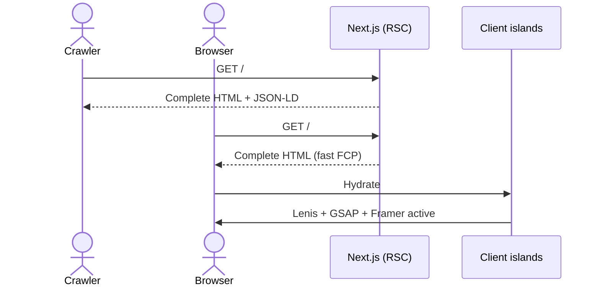

# ARCHITECTURE: ubed-web

Single Next.js 16 app. No monorepo. No database. Consumes `@ubed/ui` from npm.

## 1. System
```mermaid
graph TD
    V[Visitor / Crawler] --> W[ubed.in Next.js 16 on Vercel]
    W --> C[(MDX content in repo)]
    W --> U[@ubed/ui from npm]
    W --> F[/api/contact]
    F --> T[Turnstile verify]
    F --> R[Upstash rate limit]
    F --> M[Web3Forms or Resend]
    W -. links .-> D[ui.ubed.in docs]
```

## 2. Repo layout
```
ubed-web/
├─ src/
│  ├─ app/
│  │  ├─ (site)/page.tsx, layout.tsx
│  │  ├─ blog/page.tsx, [slug]/page.tsx, [slug]/opengraph-image.tsx, tag/[tag]/page.tsx
│  │  ├─ api/contact/route.ts
│  │  ├─ sitemap.ts, robots.ts, rss.xml/route.ts, not-found.tsx
│  ├─ components/
│  │  ├─ sections/   Hero, About, Skills, Projects, Contact, Footer (server)
│  │  ├─ islands/    *.client.tsx (GSAP, Framer, Lenis, cursor)
│  │  └─ blog/       PostCard, Toc, CodeBlock, ShareRow
│  ├─ content/blog/*.mdx
│  ├─ data/          projects.ts, skills.ts, site.ts
│  ├─ lib/           content.ts, seo.ts, schemas.ts, ratelimit.ts
│  └─ styles/        globals.css
├─ public/           fonts, blog images, stickers
├─ docs/             project documentation
└─ next.config.ts, tailwind config, package.json, tsconfig.json
```

## 3. Rendering strategy (zero SEO loss)
- Server Components deliver complete HTML: headings, project text, skills, contact details, blog content.
- Client islands (`"use client"`) add canvas, GSAP ScrollTrigger, Framer Motion, Lenis. They wrap or enhance existing DOM and never withhold text.
- All pages are statically generated (`generateStaticParams` for blog).



## 4. Animation lifecycle
- Lenis in a `SmoothScrollProvider` with `cancelAnimationFrame` cleanup.
- GSAP in `useGSAP(() => {...}, { scope: ref })`; plugins registered once, client only.
- `ScrollTrigger.refresh()` after fonts/images settle.
- Heavy sections loaded with `next/dynamic`.
- Every effect has a `prefers-reduced-motion` branch.

## 5. Routes
| Route | Purpose | Rendering |
| :-- | :-- | :-- |
| `/` | Portfolio | Static + islands |
| `/blog` | Index | Static |
| `/blog/[slug]` | Post | Static, JSON-LD, OG image |
| `/blog/tag/[tag]` | Tag archive | Static; noindex if < 2 posts |
| `/rss.xml`, `/sitemap.xml`, `/robots.txt` | Crawler files | Generated |
| `/api/contact` | Submit contact | Route handler (node) |
| not-found | 404 | Static |

All public. No auth, so no guards.

## 6. Content model
```yaml
---
title: "How I built pinned scroll sections with GSAP"
slug: gsap-pinned-scroll-sections
summary: "Why my pinned section kept jumping and the fix."   # 140-160 chars
category: Web Dev          # Web Dev | UI/UX | Architecture | Learning in Public
tags: [gsap, scrolltrigger, nextjs]
cover: /blog/gsap-pinned/cover.webp
coverAlt: "Screenshot of the pinned skills section"
publishedAt: 2026-12-01
updatedAt: 2026-12-01
draft: false
relatedComponent: velocity-marquee      # slug on ui.ubed.in (optional)
---
```
Validated by Zod at build time (`src/lib/schemas.ts`). Projects are typed data in `src/data/projects.ts`.

## 7. Using `@ubed/ui`
- Install: `pnpm add @ubed/ui` plus its peer deps (`gsap`, `@gsap/react`, `framer-motion`).
- Theme: `import '@ubed/ui/styles.css'` once in the root layout; map site tokens to `--ubed-*` in `globals.css`.
- Use components inside client islands; the package marks interactive components `"use client"`.
- Version policy: caret range; Dependabot/Renovate opens bump PRs; read the library changelog before merging majors.
- **Do not copy library code here.** If a component needs a change, change it in `ubed-ui`, release, then bump.
- Portfolio-only components (hero composition, project deck) stay in this repo. If one becomes reusable, move it to `ubed-ui` using that repo's `MAINTENANCE.md`, then replace the local copy with the import.

### Developing against an unreleased library change
| Method | When |
| :-- | :-- |
| Snapshot/prerelease from `ubed-ui` (`pnpm add @ubed/ui@beta`) | Safest; mirrors real install |
| `pnpm pack` in `ubed-ui/packages/ui` then `pnpm add ../path/ubed-ui-x.tgz` | Quick one-off test |
| `pnpm link ../ubed-ui/packages/ui` with `tsup --watch` running | Live iteration; if duplicate React errors appear, link React from this repo (`pnpm link react react-dom`) |

Never merge to `main` with a `link:` or `file:` dependency.

## 8. Contact endpoint
1. Parse body with Zod.
2. Reject if honeypot field filled.
3. Verify Cloudflare Turnstile token server-side.
4. Rate limit by IP with Upstash Ratelimit.
5. Forward via Web3Forms or Resend (key server-side only).
6. Return typed JSON; never echo raw HTML.

## 9. Tech decisions
| Tech | Purpose | Why | Alternative | Trade-off |
| :-- | :-- | :-- | :-- | :-- |
| Next.js 16 | App | RSC, static output, existing | Astro | Would lose React reuse |
| TypeScript strict | Safety | Fewer runtime bugs | n/a | Slower to write |
| Tailwind | Styling | Existing stack | CSS Modules | Consumers' classes vs package CSS (handled by `styles.css`) |
| GSAP, Framer Motion, Lenis | Motion | Existing | CSS scroll-driven animation | Bundle cost; keep islands lazy |
| MDX (Velite or next-mdx-remote) | Blog | Typed, static | DB CMS | Edit via git |
| Zod | Validation | Form + frontmatter | Valibot | Slightly larger |
| Upstash + Turnstile | Form protection | Free, serverless-safe | In-memory limit | Two services |
| Vitest, Playwright, axe, Lighthouse CI | Testing | Fast + real browser + a11y + perf | Jest/Cypress | CI time |
| Vercel Analytics + Speed Insights | Monitoring | Free, zero config | Plausible/Umami | Limited on Hobby |

## 10. SEO
- `generateMetadata` per route (title < 60 chars, description < 160), canonical, robots.
- `opengraph-image.tsx` for posts.
- JSON-LD: Person + WebSite (home), `BlogPosting` and `BreadcrumbList` (posts).
- `sitemap.ts` lists only `ubed.in` URLs; the UI site has its own sitemap.
- One canonical host; redirect `www` to apex (or reverse), `http` to `https`.
- `next/font` with fallbacks; reserve sticker sizes to avoid CLS.
- Internal links: posts to component pages on `ui.ubed.in` and each other; footer links to both.

## 11. Security
- Secrets only in Vercel/GitHub secrets; only `NEXT_PUBLIC_*` reaches the client.
- Security headers in `next.config` (HSTS, `X-Content-Type-Options`, `Referrer-Policy`, `Permissions-Policy`, frame-ancestors); test CSP with GSAP/analytics before enforcing.
- Dependabot/Renovate, `pnpm audit` in CI, secret scanning, branch protection.

## 12. Testing
| Layer | Tool | What |
| :-- | :-- | :-- |
| Static | tsc, ESLint, Prettier | Zero errors |
| Unit | Vitest | `lib/` helpers, schemas, content loader |
| E2E | Playwright | Home, blog, post, tag, contact (mock), 404 |
| A11y | axe + Playwright | No serious/critical on public routes |
| Perf | Lighthouse CI | Perf 95, A11y 100, SEO 100, CLS 0.05 |

## 13. Future (not now)
Add Postgres + Prisma only for comments, view counts, newsletter or accounts. Add Keystatic/Decap if editing in the IDE becomes a burden.
