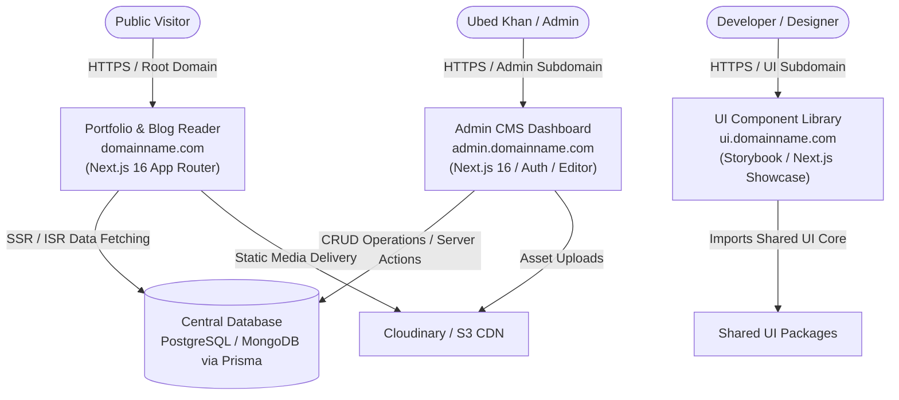
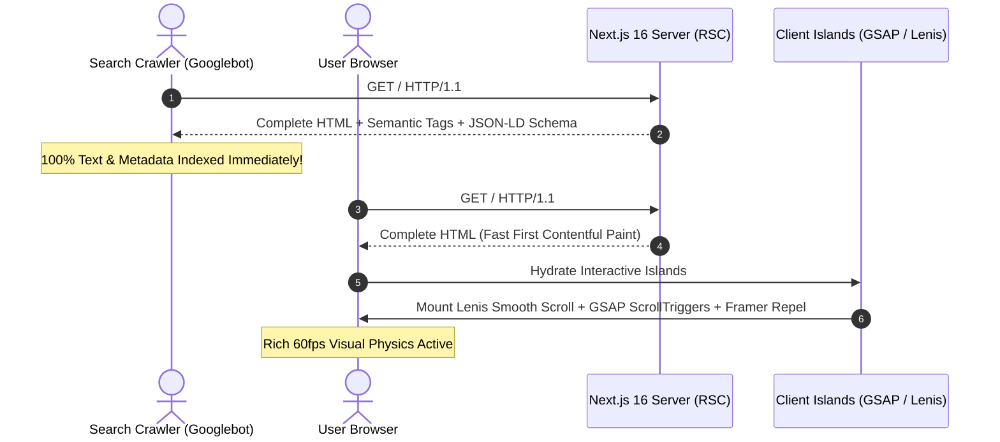

# Architecture Specification (ARCHITECTURE.md)

## 1. High-Level System Architecture

The Ubed Khan digital ecosystem is engineered as a decoupled, multi-subdomain system powered by **Next.js 16**, **TypeScript**, and a unified backend data layer.



---

## 2. Next.js 16 App Router Structure

The application leverages the Next.js 16 App Router with route grouping, Server Component layout rendering, and optimized font loading.

```
src/app/
├── (site)/                        # Main portfolio route group
│   ├── page.tsx                   # Server Component: composed portfolio page
│   └── layout.tsx                 # Root layout with fonts, metadata, providers
├── blog/                          # Public blog reader
│   ├── page.tsx                   # Blog list (Server Component + ISR)
│   └── [slug]/
│       ├── page.tsx               # Blog article (Server Component + SEO Schema)
│       └── opengraph-image.tsx    # Dynamic OpenGraph image generator
├── api/                           # Backend API Route Handlers
│   ├── contact/route.ts           # Secure contact form endpoint
│   └── blogs/route.ts             # REST endpoint for blog queries
├── globals.css                    # Tailwind CSS + custom utilities
├── sitemap.ts                     # Dynamic sitemap.xml generator
├── robots.ts                      # Dynamic robots.txt generator
└── not-found.tsx                  # Custom 404 page
```

---

## 3. Server Component Island Pattern (Zero-SEO-Loss)

### 3.1 The Problem
In standard single-page React applications (such as Vite SPAs), content is mounted dynamically by client-side JavaScript. Web crawlers with delayed JavaScript evaluation or strict budgets may index an empty shell or fail to discover headings, project links, and semantic structure.

### 3.2 The Solution: Server First + Client Islands
1. **Server Components (RSC) deliver the initial DOM**:
   - Headings (`<h1>UBED KHAN</h1>`, `<h2>PROJECTS</h2>`, `<h2>SKILLS</h2>`), project titles, descriptions, skills lists, contact details, and blog content are rendered server-side.
   - The initial HTTP response contains complete, structured HTML that is instantly crawlable by search engines.
2. **Client Islands (`"use client"`) layer interactive physics**:
   - Canvas animations, GSAP ScrollTrigger pins, Framer Motion spring repulsions, and Lenis smooth scrolling are scoped inside isolated client wrappers.
   - The animations enhance existing DOM nodes or wrap interactive elements (like buttons and avatars) without replacing or withholding text.



---

## 4. Animation Pipeline & Lifecycle Management

### 4.1 Libraries & Roles
- **Lenis (`@studio-freight/lenis` / `lenis`)**: Smooth scrolling provider, synchronizing browser scroll coordinates with high-performance CSS transforms (`translate3d`).
- **GSAP & ScrollTrigger (`@gsap/react`)**: Scroll-driven pinned timelines (Skills section, Projects 3D deck stack), scroll-velocity marquee multipliers, and parallax sticker triggers.
- **Framer Motion (`framer-motion`)**: Interactive physics-based spring interactions (`whileHover`, `whileTap`, repel calculations) on buttons and avatars.

### 4.2 Hydration & Cleanup Protocol
To eliminate hydration mismatches, memory leaks, and pinned-spacer calculation errors:
- All GSAP effects are enclosed within `useGSAP(() => { ... }, { scope: containerRef })`.
- GSAP automatically kills and cleans up triggers on unmount.
- Lenis runs within a dedicated `SmoothScrollProvider` with `cancelAnimationFrame` cleanup.

---

## 5. Database CMS Architecture (Option B)

### 5.1 Technology Choice
- **Database**: PostgreSQL (hosted on Neon/Supabase) or MongoDB Atlas.
- **ORM / Query Engine**: Prisma ORM with strict TypeScript client generation (`@prisma/client`).
- **Data Mutation**: Next.js Server Actions with Zod schema validation.

### 5.2 Core Schema Models

```prisma
datasource db {
  provider = "postgresql"
  url      = env("DATABASE_URL")
}

generator client {
  provider = "prisma-client-js"
}

model BlogPost {
  id          String   @id @default(cuid())
  slug        String   @unique
  title       String
  summary     String
  content     String   // Full Markdown or Rich Text HTML
  category    String
  tags        String[]
  coverImage  String?
  published   Boolean  @default(false)
  viewCount   Int      @default(0)
  publishedAt DateTime?
  createdAt   DateTime @default(now())
  updatedAt   DateTime @updatedAt

  authorId    String
  author      Author   @relation(fields: [authorId], references: [id])
}

model Author {
  id        String     @id @default(cuid())
  name      String
  email     String     @unique
  avatar    String?
  bio       String?
  posts     BlogPost[]
}

model Project {
  id          String   @id @default(cuid())
  slug        String   @unique
  title       String
  subtitle    String
  description String
  features    String[]
  tech        String[]
  image       String
  githubUrl   String?
  liveUrl     String?
  order       Int      @default(0)
  published   Boolean  @default(true)
}

model UIComponent {
  id          String   @id @default(cuid())
  slug        String   @unique
  name        String
  category    String
  description String
  code        String
  previewUrl  String?
  published   Boolean  @default(true)
}
```

---

## 6. Security & Environment Configuration

### 6.1 Server vs Client Secrets
- Client-safe variables must be prefixed with `NEXT_PUBLIC_` (e.g. `NEXT_PUBLIC_SITE_URL`).
- Sensitive keys (e.g. `DATABASE_URL`, `WEB3_API_KEY`, `ADMIN_SECRET_KEY`) reside exclusively in server environments and are never bundled into client JavaScript.

### 6.2 Contact Form Security
The contact form submits directly to the internal Next.js Route Handler `/api/contact`, which:
1. Validates input fields using a Zod schema.
2. Applies rate limiting.
3. Forwards the message to Web3Forms or an SMTP transport server-side, protecting the API key from public scraping.
