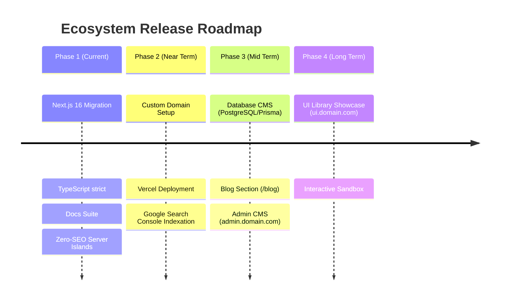

# Product Requirements Document (PRD)

## 1. Executive Summary & Vision
**Product Name:** Ubed Khan — Full-Stack Developer & UI/UX Designer Portfolio Ecosystem  
**Target Domain:** `ubed.in` (Main Site & Blog Reader), `admin.ubed.in` (CMS App), `ui.ubed.in` (UI Component Library)  
**Vision:** Establish an authoritative, ultra-high-performance web presence that highlights Ubed Khan's engineering craftsmanship, distinctive typography aesthetic, and fluid visual interactions. The platform serves as an interactive portfolio, technical thought leadership hub (blog), showcase for custom UI components, and a centralized CMS platform.

---

## 2. Target Personas
1. **Tech Recruiters & Engineering Leads:** Seeking full-stack expertise (MERN, Next.js, TypeScript, PostgreSQL/MongoDB), clean architecture, performance, and attention to detail.
2. **Startup Founders & Freelance Clients:** Looking for an end-to-end builder capable of delivering high-impact, custom-branded web applications.
3. **Frontend & Design Engineers:** Exploring interactive UI components, animations, and technical insights from the blog and UI library.

---

## 3. Core Goals & Success Metrics (KPIs)

| Metric | Target | Measurement Method |
| :--- | :--- | :--- |
| **Google Lighthouse Performance** | 95+ | Chrome DevTools Lighthouse audit (Mobile & Desktop) |
| **Cumulative Layout Shift (CLS)** | < 0.05 (Ideal: 0.00) | Web Vitals with `next/font` local font fallback overrides |
| **SEO Indexation** | 100/100 | Server-rendered semantic HTML, Schema.org JSON-LD |
| **Type Safety** | 100% strict | Zero TypeScript compilation errors (`tsc --noEmit`) |
| **Smooth Scroll Frame Rate** | Constant 60fps / 120Hz | Chrome Rendering FPS meter with Lenis GPU transforms |

---

## 4. Product Features & Scope

### 4.1 Main Portfolio Site (`ubed.in`)
- **Hero Section**:
  - Monumental "UBED KHAN" typography powered by Republica Minor font.
  - Interactive Bitmoji avatar with physics-driven repel and tap spring feedback.
  - Rotating animated tagline ("web developer" / "UI/UX designer").
  - Quick CTA button with spring bounce physics.
- **Marquee Velocity Slider**:
  - Dual-row infinite ribbon dynamically accelerating based on user scroll velocity.
- **About Me Section**:
  - Glassmorphic card with word-by-word scroll reveal animation.
  - Dual-layer animated floating stickers (Bubble, Dice, Heart, Diamond) combining idle yoyo bobbing and ScrollTrigger scrub parallax.
  - Direct resume access button.
- **Skills Section**:
  - Pinned GSAP ScrollTrigger timeline smoothly sequencing skill badges across responsive rows.
  - Parallax corner icons (laptop, lightbulb, hand, brain).
- **Projects Section**:
  - Dual-ribbon animated "PROJECTS" header.
  - Pinned 3D card deck stack where previous cards smoothly scale and dim while next cards slide in.
  - Project metadata: Live URL, GitHub repo, feature highlights, tech tags, screenshot.
- **Contact Section**:
  - Scroll-triggered text unmasking wipe effect ("LET'S BUILD SOMETHING COOL TOGETHER").
  - Secure contact form connecting to Next.js API route (`/api/contact`).
- **Footer**:
  - High-impact typography, quick navigation, social links, and animated neon SVG matrix (`FooterBlinker`).
- **Custom Cursor (`MouseFollower`)**:
  - Fluid difference-blend-mode cursor tracking mouse coordinates.

### 4.2 Blog Reader Section (`ubed.in/blog`)
- Public listing of published technical articles categorized by topic (Web Dev, UI/UX, Architecture).
- Individual article pages (`/blog/[slug]`) rendered with dynamic OpenGraph images, reading time, and author metadata.
- Pre-rendered Server Components for zero-latency crawler indexing and Google Discover eligibility.

### 4.3 Future Admin CMS (`admin.ubed.in`) *(Architectural Scope)*
- Dedicated application deployed on the `admin` subdomain.
- Secure authentication for Ubed Khan.
- Capabilities:
  - Create, update, draft, and publish blog articles.
  - Manage featured projects and update screenshots.
  - Register and document new components for the UI Library.

### 4.4 Future UI Component Library (`ui.ubed.in`) *(Architectural Scope)*
- Interactive component showcase and documentation hub.
- Live sandbox previews and copy-to-clipboard code snippets.

---

## 5. Non-Functional Requirements
- **Server-First Rendering**: Semantic HTML markup must be delivered directly in the initial HTTP response for web crawlers before client-side hydration.
- **Accessibility (a11y)**: WCAG 2.1 AA compliance, including descriptive alt attributes, ARIA landmarks, keyboard focus management, and color contrast.
- **Cross-Browser & Device Responsiveness**: Flawless presentation across phones (320px+), tablets (768px), laptops (1024px), desktops (1440px), and ultrawide screens (1920px+).
- **Zero CLS Typography**: Local and remote fonts optimized using `next/font` with zero layout shifting.

---

## 6. Release Roadmap

